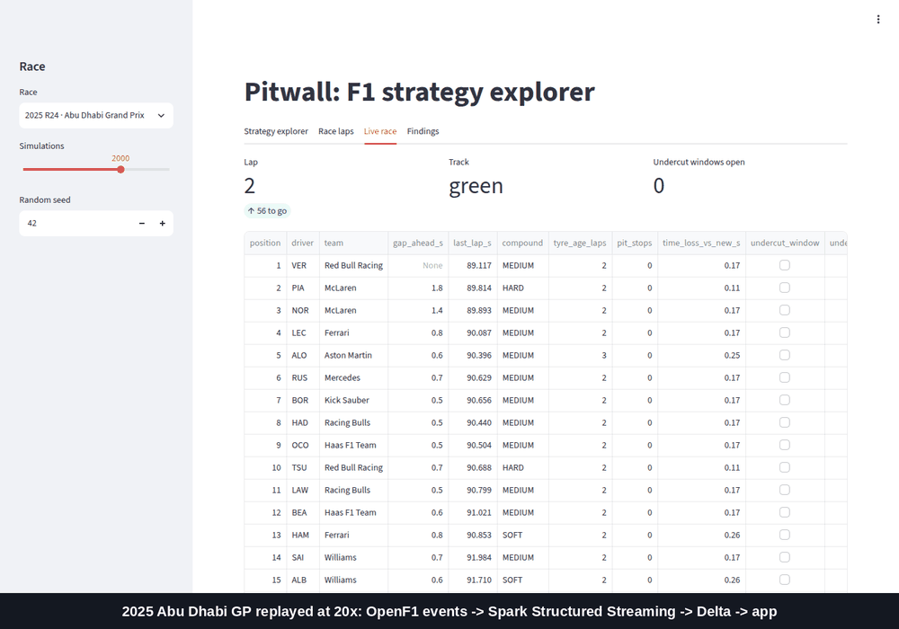

# 🏁 Pitwall — Quantifying F1 race strategy under uncertainty

> *How fast do tires really wear? Does the undercut actually work? What should teams have done?*
> Bayesian, causal and simulation models on a Spark + Delta Lake lakehouse built from F1 timing data: results 2018–2025, laps, tyres and weather 2023–2025.


📝 **Blog post:** [Tyres, undercuts and a million simulated races](docs/blog/f1-strategy-under-uncertainty.md), the story of the project, what worked and what didn't.

## Key findings

Each finding states its uncertainty. The full write-ups (method, robustness, limitations) are linked.

| Question | Finding | Report |
|---|---|---|
| RQ1 — Tire degradation | Fuel-corrected wear of **0.065 / 0.058 / 0.040 s per lap** of tyre age (soft / medium / hard; 90% CIs ±0.013–0.017). Circuits vary about 7× more than drivers, and hotter tracks wear faster. The best held-out 2025 stint forecasts (RMSE 1.17 s vs 1.23 for the baseline), but intervals are too narrow (82% coverage for 90%). | [`reports/rq1_tire_degradation.md`](reports/rq1_tire_degradation.md) |
| RQ2 — Does the undercut work? | Yes, where tyres wear. In a shared pit cycle, stopping first raises the chance of coming out ahead by **+38 pp (95% CI +26 to +49)**: about +50 pp at medium- and high-wear circuits, about 0 at low-wear ones. Robust to balance, overlap and permutation checks (E-value 5.4). A placebo shows cars that stop first were already fading; controlling for it gives +44 pp. | [`reports/rq2_undercut.md`](reports/rq2_undercut.md) |
| RQ3 — Optimal strategy | A full-field simulator beats "finish = grid" on 2025 (RPS **0.128 vs 0.176**, 19 of 24 races) and runs **10⁶ races in 20 s** on a laptop. It is overconfident, though, and its "teams left points on the table" estimates aren't credible. Reported as a negative result: forecasting results is easier than ranking counterfactual strategies. | [`reports/rq3_strategy.md`](reports/rq3_strategy.md) |
| RQ4 — Pre-race predictions (stretch) | **The grid is hard to beat.** Boosting on qualifying, form and circuit history, with isotonic calibration, is well calibrated (podium ECE **0.013**) but no more accurate than grid position alone: podium Brier 0.074 vs **0.070**, points 0.162 vs 0.165 (CI includes 0). A Plackett–Luce rank model is coherent but far too flat at the front (ECE 0.11). | [`reports/rq4_calibrated_predictions.md`](reports/rq4_calibrated_predictions.md) |

## Approach

| | Method | Why |
|---|---|---|
| RQ1 | Hierarchical Bayesian regression (PyMC, nutpie) vs per-stint OLS and LightGBM baselines | Circuits with few races borrow strength from others; the full posterior feeds the simulator |
| RQ2 | Double ML + inverse propensity weighting, cross-fitted by race, with placebo and E-value checks | Pit timing is confounded; naive comparisons are biased |
| RQ3 | Full-field Monte Carlo race simulator distributed on Spark, backtested on 2025 | Decisions under uncertainty need distributions, not point estimates |
| RQ4 | Gradient boosting + isotonic/Platt calibration and a Plackett–Luce rank model, rolling origin by race | A probability is only useful if it's calibrated, and only interesting if it beats the grid |

The plan was written before modeling. The estimand, evaluation and every later change are in [docs/research-plan.md](docs/research-plan.md), with changes logged in its deviations table (§6).

## Architecture

```
Jolpica API ─────┐
OpenF1 API ──────┼─► Bronze (raw) ─► quality gates ─► Silver (clean) ─► Gold (star schema) ─► Features ─► Models ─► App / reports
FastF1 (inactive)┘                       └─► Quarantine                                                    └─► MLflow
```

- **Lakehouse:** Delta Lake, medallion layers, MERGE-based idempotent loads, SCD2 driver–team dimension, deterministic hash keys
- **Compute:** PySpark (ETL, features, distributed simulation) + PyMC / scikit-learn / EconML (modeling on feature tables)
- **Orchestration:** Dagster assets partitioned by season, with weekly maintenance (OPTIMIZE, Z-order, VACUUM)
- **Quality:** expectations with quarantine and a per-run DQ log; facts checked for unique keys and orphaned foreign keys before every write; rebuilding a season gives bit-identical tables (checked with row counts + checksums)
- **Race day:** Spark Structured Streaming turns OpenF1 events into a live race state, exactly once. It is fed by a replay of any past race or, on OpenF1's paid tier, the live MQTT feed. Each car carries its RQ1 tyre-wear cost and an RQ2 undercut-window flag ([ADR-0007](docs/adr/0007-race-day-streaming.md))
- **Cloud:** config-only profiles for S3, EMR Serverless (Terraform) and Databricks (Asset Bundle). A season rebuilt on S3 matches the local lakehouse table for table ([runbook](docs/cloud.md), [ADR-0008](docs/adr/0008-cloud-deployment.md))
- **Docs:** [Architecture (SAD)](docs/SAD.md) · [Data model / ERD](docs/data-model.md#erd) · [ADRs](docs/adr/) · [Roadmap](docs/roadmap.md)

<details>
<summary>Dagster asset lineage (<code>make dagster</code>)</summary>


</details>

**Data-source note.** Since October 2026 the F1 timing archive behind FastF1 needs an F1 TV login. Lap-level data therefore comes from [OpenF1](https://openf1.org), which is free but starts in 2023. Silver keeps the same schemas whichever source fed it, and the FastF1 path is still in the code. See [ADR-0006](docs/adr/0006-openf1-as-lap-data-source.md).

## Quickstart

Requires Docker (on Windows, Docker Desktop with WSL2).

```bash
cp .env.example .env
make up              # build + start workbench and MLflow (:5000)
make test            # unit tests (make test-all adds the slow model-recovery test)
make demo            # small end-to-end run: one season of results, two races of laps, a quick RQ1 fit
make app             # strategy explorer at http://localhost:8501 (works on a demo race with no data)
```

Full rebuild and all research (API rate limits make the backfill take about an hour):

```bash
make backfill        # Jolpica results 2018–2025, OpenF1 laps 2023–2025 -> bronze/silver/gold
make research        # features, EDA, RQ1–RQ4 -> reports/ + MLflow runs
make perf            # layout evidence for the engineering notes
make dagster         # asset graph at http://localhost:3000
```

Race day and cloud:

```bash
make stream-replay SEASON=2025 ROUND=24   # replay a race through Structured Streaming; watch the app's Live race tab
make s3-verify SEASON=2024                # rebuild a season on a local S3 store and compare with the local lakehouse
```

`pitwall stream live` reads OpenF1's live feed during a session (Sponsor tier; set `OPENF1_USERNAME` / `OPENF1_PASSWORD`). AWS and Databricks deployment steps are in [docs/cloud.md](docs/cloud.md).



## Repository layout

```
conf/            configuration: base + environment profiles (local, s3local, s3, aws, databricks)
deploy/          AWS (Terraform, EMR image, job submit), local S3 verification
docs/            SAD, data model, research plan, roadmap, ADRs, cloud runbook, blog post, images
src/pitwall/     package: ingestion, bronze, silver, gold, features, quality, models, simulation,
                 streaming (race day), orchestration, research (RQ runs), serving (app reads),
                 tracking (MLflow)
tests/           unit tests (local Spark + Delta), slow model-recovery test
notebooks/       exploration (outputs stripped)
reports/         write-ups per research question, figures and result files
app/             Streamlit strategy explorer
```

## Engineering notes

Measured on an 8-core / 16-thread laptop (i7-11800H, Spark `local[*]` in Docker). Numbers come from `make perf` ([`reports/engineering/layout.json`](reports/engineering/layout.json)) and the RQ3 runs.

**Data volume.**

| Data | Rows | Seasons |
|---|---|---|
| Race results | 3,938 | 2018–2025 |
| Laps | 77,238 | 2023–2025 |
| Car telemetry samples | 16.5M | 2024 |
| Position telemetry samples | 17.0M | 2024 |
| Simulated races per decision analysis | ~210M | — |

**Small files, found by measuring.** One season of `silver.telemetry_car` was stored as **456 files averaging 0.6 MB**: about 19 per race, one per shuffle task of the dynamic partition overwrite. A query for one driver in one race read **19 files**.

| Fix | Files | Mean file | Files read | Query time |
|---|---|---|---|---|
| Before | 456 | 0.6 MB | 19 | 0.47 s |
| `OPTIMIZE` + `ZORDER BY (driver_number)` | 24 | 5.8 MB | 1 | 0.29 s (−40%) |
| Repartition by partition columns before writing (the fix at the source) | 24 straight from the write | 5.8 MB | 1 | same as OPTIMIZE |

Rebuilds now produce the compacted layout directly, and the weekly Dagster maintenance job keeps tables compacted after incremental loads.

**What didn't need tuning.** A season of laps is about 3 MB, so each `season` partition is a single file. Partition pruning does all the work there, and Z-order has nothing to skip (1 file read before and after). Key skew is mild: max/median rows is 1.4 per race, 1.4 per driver-race and 1.4 per circuit, so AQE's skew-join handling has nothing to fix. Small dimensions are broadcast.

**Simulation scaling.** 200,000 races take 14.4 s on 1 task and 4.7 s on 8 (3.1×). Going to 16 tasks doesn't help, because there are 8 physical cores and per-task overhead dominates short tasks. A million races take 20.5 s. The decision analysis (about 210M races) saturates all threads for about 45 minutes; that is the workload Spark is for here.

**Correctness at scale.**
- **Idempotency:** rebuilding a season from bronze reproduces every silver and gold table bit-for-bit (row count + checksum), checked after two fixes it uncovered: run-order-dependent MERGE and float aggregation order.
- **Integrity:** facts are checked for unique primary keys and orphaned foreign keys before every write; a fan-out join was caught this way.
- **Quality:** the worst quarantine rate is 0.42% (2023 laps, mostly implausible lap times from red-flag laps). Every one of the 151 gate runs is logged in `quarantine/_dq_runs`.

**Streaming, measured** ([`streaming.json`](reports/engineering/streaming.json)). The 2025 Abu Dhabi GP was replayed at 60× (2,027 events in about 90 s) three times.
- **Batch cost is fixed overhead:** each micro-batch takes about 8 s whether it holds 1 event or 300. That's Spark job and Delta commit overhead (a one-row Delta append alone takes over 1 s on Docker Desktop's disk), so wider or narrower shuffles changed nothing.
- **Latency:** at 60×, events queue behind the previous batch, giving 17–20 s median and about 25 s p95 from emitted to state written. At real-time pace that is about one batch plus a trigger (an estimate, not measured over a full race).
- **Two fixes found by measuring:** each batch first re-read the whole Delta log, so cost grew with the race; the session log now stays in memory. And reusing Delta's idempotency id across checkpoints silently skipped a fresh run's batches; the id now changes with the checkpoint (regression-tested).

**Object storage, verified without a cloud bill.**
- **S3:** a season's bronze was copied to an S3-compatible store (SeaweedFS in Docker), and silver and gold were rebuilt through `s3a://`. All 13 season tables (62,660 rows) match the local lakehouse ([`cloud_verification.json`](reports/engineering/cloud_verification.json)).
- **EMR image:** inside the EMR Serverless image, pitwall runs on EMR's own Spark 3.5.2 and Delta 3.2.1. A season's gold tables, including 16.5M telemetry rows, fingerprint identically ([`emr_image_check.json`](reports/engineering/emr_image_check.json)). This check caught a missing `spark.submit.pyFiles` for Delta's Python API before any job ran in AWS.

## Data & license

Data comes from [Jolpica-F1](https://github.com/jolpica/jolpica-f1), [OpenF1](https://openf1.org) and (when accessible) [FastF1](https://github.com/theOehrly/Fast-F1). It is unofficial and used for non-commercial, educational purposes. No raw data is committed to this repository. This project is not associated with Formula 1 or the FIA.
