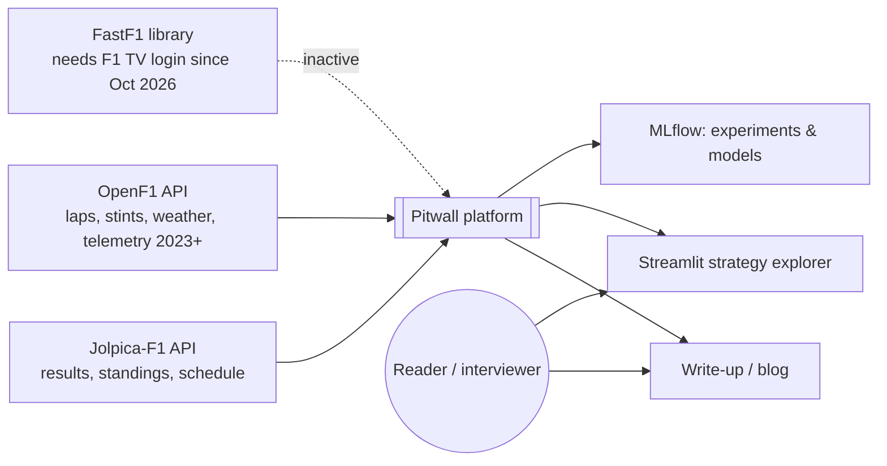
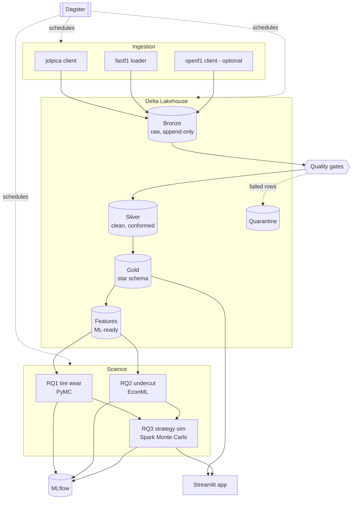
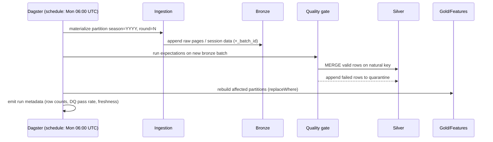
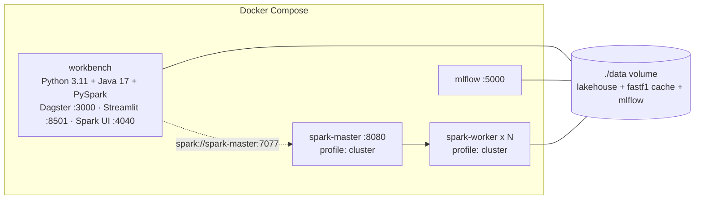

# Pitwall — Software Architecture Document (SAD)

| | |
|---|---|
| **Project** | Pitwall: Quantifying F1 race strategy under uncertainty |
| **Version** | 0.2 (lap source: OpenF1) |
| **Status** | Draft |
| **Template** | Loosely follows [arc42](https://arc42.org) |
| **Related docs** | [Research plan](research-plan.md) · [Data model](data-model.md) · [Roadmap](roadmap.md) · [ADRs](adr/) |

---

## 1. Introduction and goals

### 1.1 Purpose

Pitwall is a data science project. Its job is to answer three questions about Formula 1 race strategy, each with honest uncertainty estimates:

| ID | Research question | Main method |
|---|---|---|
| **RQ1** | How much lap time does a tire lose per lap, by compound and by circuit? | Bayesian hierarchical regression |
| **RQ2** | Does pitting before a close rival (the "undercut") cause a position gain? | Causal inference (DML / propensity weighting) |
| **RQ3** | Given RQ1 and RQ2, what strategy maximizes expected points, and how often did teams pick it? | Distributed Monte Carlo simulation |
| RQ4 (stretch) | Can we produce *calibrated* finishing-position probabilities before a race? | Probabilistic classification + calibration |

The data platform (lakehouse, pipelines, data model) exists **to serve these questions**. It is deliberately solid but not the headline. See the [research plan](research-plan.md) for hypotheses, estimands and evaluation.

### 1.2 Quality goals (ranked)

| # | Quality goal | What it means here |
|---|---|---|
| 1 | **Analytical validity** | No leakage, time-aware validation, uncertainty reported, assumptions stated |
| 2 | **Reproducibility** | Anyone can rebuild every table and result from a clean clone with one command; runs are tracked |
| 3 | **Correctness of data** | Quality gates between layers; bad records are quarantined, never silently dropped |
| 4 | **Idempotency** | Re-running any pipeline step for any season gives the same result with no duplicates |
| 5 | **Scalability** | Telemetry (~10⁸–10⁹ rows) and simulation (~10⁶–10⁷ races) scale horizontally with Spark |
| 6 | **Communicability** | Results are readable by non-experts (write-up, app) |

### 1.3 Stakeholders

| Stakeholder | Expectation |
|---|---|
| Hiring managers / DS interviewers | Clear questions, rigorous methods, defensible conclusions |
| Data/ML engineers reviewing the repo | Clean architecture, tests, best practices |
| Author | A maintainable codebase that can grow phase by phase |

---

## 2. Constraints

| Type | Constraint | Consequence |
|---|---|---|
| Budget | $0 baseline; cloud only for optional scale demos | Local-first stack; cloud must be config-only change |
| Hardware | One laptop (Windows + Docker/WSL2) | Spark runs in Docker; sampled dev datasets |
| Data licensing | Jolpica / FastF1 / OpenF1 data is unofficial and for non-commercial use | Portfolio/educational use only; no redistribution of raw data in the repo |
| API limits | Jolpica: ~4 req/s burst, ~500 req/hour | Client-side rate limiter; cache raw responses in bronze |
| Data coverage | Lap-level timing, tyres and telemetry only from 2023 (OpenF1; the FastF1 archive needs an F1 TV login since Oct 2026) | RQ1–RQ3 scoped to 2023–2025; results 2018+ used for dimensions/history/priors ([ADR-0006](adr/0006-openf1-as-lap-data-source.md)) |
| Live data | OpenF1 real-time access may require an account | Streaming is an optional phase |

---

## 3. Context and scope

### 3.1 System context



### 3.2 External interfaces

| Source | Access | Grain | Volume (2018 onward) | Refresh |
|---|---|---|---|---|
| Jolpica-F1 (`api.jolpi.ca/ergast/f1`) | REST/JSON, paginated (`limit`/`offset`) | race result, qualifying, pit stop, driver, constructor, circuit | small (10⁵ rows) | after each race weekend |
| OpenF1 (`api.openf1.org/v1`) | REST/JSON, filter by `session_key` (+ `driver_number` for telemetry), ~30 req/min | lap, stint, pit, position, race control, weather, car telemetry, location (2023+) | large (10⁸ telemetry rows) | post-session |
| FastF1 (inactive, [ADR-0006](adr/0006-openf1-as-lap-data-source.md)) | Python lib over the F1 timing archive, which needs an F1 TV login since Oct 2026 | lap, stint, telemetry, weather (2018+) | large | — |

**Out of scope:** betting odds, team radio audio, onboard video, official FIA documents.

---

## 4. Solution strategy

| Concern | Decision | ADR |
|---|---|---|
| Storage | Lakehouse on **Delta Lake**, local filesystem first, cloud object storage by config | [ADR-0001](adr/0001-local-first-delta-lakehouse.md) |
| Layering | **Medallion** (bronze → silver → gold) with quality gates between layers | [ADR-0002](adr/0002-medallion-and-dimensional-model.md) |
| Serving model | **Kimball star schema** in gold + separate ML feature tables | [ADR-0002](adr/0002-medallion-and-dimensional-model.md) |
| Compute | **PySpark** for ETL, telemetry features and simulation; pandas/PyMC for single-node modeling | [ADR-0003](adr/0003-spark-for-scale-single-node-for-modeling.md) |
| Orchestration | **Dagster** assets (each table = one asset, partitioned by season) | [ADR-0004](adr/0004-dagster-orchestration.md) |
| Modeling | **PyMC** (Bayesian), **EconML/DoWhy** (causal), **MLflow** tracking | [ADR-0005](adr/0005-modeling-stack.md) |
| Lap-level source | **OpenF1** (2023+); FastF1 kept as an inactive alternative | [ADR-0006](adr/0006-openf1-as-lap-data-source.md) |
| Cloud | Config-only profiles (`s3local`, `s3`, `aws`, `databricks`); EMR Serverless via Terraform, Databricks via Asset Bundle; verified on local S3 | [ADR-0008](adr/0008-cloud-deployment.md) |
| Validation | Temporal splits by season/race; never random splits | [Research plan §2](research-plan.md#2-cross-cutting-methodology) |

---

## 5. Building block view

### 5.1 Level 1 — Main components



### 5.2 Code layout (maps 1:1 to components)

```
src/pitwall/
├── config.py            # typed settings (conf/*.yaml + env overrides)
├── spark.py             # SparkSession factory (Delta, AQE, UTC)
├── paths.py             # table path conventions per layer
├── asof.py              # backward as-of join (point-in-time correct by construction)
├── ingestion/           # Jolpica + OpenF1 clients (rate-limited), FastF1 loader (inactive)
├── bronze/              # generic append-only writer (+ ingestion metadata)
├── silver/              # per-source transforms, spec registry, MERGE, driver_id_map
├── gold/                # dims (incl. SCD2), facts, keys, integrity checks, writers
├── features/            # one builder per RQ: tire_degradation, pit_decision, race_sim_params
├── quality/             # expectations, quarantine, DQ run log
├── models/              # RQ1 Bayesian model + baselines + evaluation; RQ2 causal estimators
├── simulation/          # RQ3 field simulator, strategies, scoring, Spark distribution
├── orchestration/       # Dagster assets, jobs, schedules
├── pipelines.py         # data-platform I/O wiring (CLI + Dagster share it)
├── research.py          # feature builds + end-to-end RQ runs (MLflow, reports/)
├── tracking.py          # MLflow runs with git SHA, Delta versions, seed, config
├── serving.py           # Spark-free reads (delta-rs) for the Streamlit app
├── maintenance.py       # OPTIMIZE / Z-order / VACUUM, skew diagnostics
└── cli.py               # `pitwall ...` entry point
```

---

## 6. Data architecture

### 6.1 Medallion layers — contracts

| Layer | Purpose | Format & write mode | Schema | Guarantees |
|---|---|---|---|---|
| **Bronze** | Faithful copy of source + lineage | Delta, **append-only** | Source schema (FastF1) or raw JSON string (APIs) + `_ingested_at`, `_source`, `_batch_id`, `_request` | Never edited; replayable |
| **Silver** | One clean, typed, deduplicated version of each entity | Delta, **MERGE on natural key** | Explicit, snake_case, SI units (seconds, km/h, °C) | Passes all `error` expectations; failures → quarantine |
| **Gold** | Business-facing dimensional model | Delta, **overwrite by partition** (`replaceWhere season = …`) | Star schema, surrogate keys | Referential integrity between facts and dims |
| **Features** | Model-ready tables, one per research question | Delta, overwrite by partition | Documented feature spec per RQ | Point-in-time correct (no future info) |
| **Quarantine** | Rejected records with reason | Delta, append | Silver schema + `_failed_expectations` | Monitored; counts reported per run |

### 6.2 Table inventory (initial)

| Bronze | Silver | Gold | Features |
|---|---|---|---|
| `jolpica_results`, `jolpica_qualifying`, `jolpica_pitstops`, `jolpica_drivers`, `jolpica_constructors`, `jolpica_circuits`, `jolpica_races` | `results`, `qualifying`, `pit_stops`, `drivers`, `constructors`, `circuits`, `races` | `dim_driver`, `dim_constructor`, `dim_circuit`, `dim_session`, `dim_compound`, `dim_date`, `dim_driver_team` (SCD2) | `feat_tire_degradation` (RQ1), `rq1_degradation_posterior` (RQ1 → RQ3) |
| `openf1_laps`, `openf1_stints`, `openf1_pit`, `openf1_position`, `openf1_race_control`, `openf1_weather`, `openf1_drivers`, `openf1_car_data`, `openf1_location` (`fastf1_*` inactive) | `laps`, `telemetry_car`, `telemetry_pos`, `weather`, `race_control`, `driver_id_map` | `fact_lap`, `fact_stint`, `fact_pit_stop`, `fact_session_result`, `fact_telemetry_sample` | `feat_pit_cycle` + `feat_pit_decision` (RQ2), `feat_race_sim_params` + `feat_race_sim_cars` (RQ3), `feat_prerace` (RQ4, not built) |

Full schemas, grains and the ERD are in [data-model.md](data-model.md).

### 6.3 Physical layout

| Table class | Partitioning | Clustering | Rationale |
|---|---|---|---|
| Small dims | none | — | < 10k rows; broadcast in joins |
| `fact_lap`, `fact_stint` | `season` | Z-order `event_round, driver_key` | ~25k laps/season; queries filter by season/race |
| Telemetry (silver + gold) | `season`, `event_round`, `session_type` | Z-order `driver_number` | Largest tables; avoid many tiny files by sizing target ~128 MB |
| Features | `season` | — | Temporal splits read whole seasons |

Maintenance: `OPTIMIZE` + `VACUUM` (retention ≥ 7 days) as a scheduled Dagster job. Known skew: some circuits have more laps and some sessions more cars. AQE skew-join handling stays on, and skew gets measured and written up in Phase 2.

### 6.4 Keys and identity

- **Natural keys** are kept in silver (e.g. `season, round, session_type, driver_number, lap_number`).
- **Surrogate keys** in gold are **deterministic hashes** (`xxhash64` of the natural key). Rebuilds then stay idempotent, and facts can load without looking up dims.
- **Cross-source identity:** Jolpica uses `driverId` (`max_verstappen`), FastF1 uses abbreviation (`VER`) and car number (which can change over time). `silver.driver_id_map` reconciles them per season and is a tested, first-class table.

---

## 7. Runtime view

### 7.1 Post-race-weekend batch (incremental)



### 7.2 Backfill

Same assets, run for a range of season partitions (`2018…2025`). This works because every step is idempotent. Bronze may receive duplicate batches; silver's MERGE + dedup window removes them.

### 7.3 Model training & simulation

1. Build `feat_*` for the training seasons.
2. Fit the model (single node). Log params, metrics, diagnostics (R-hat, ESS, PPC plots) and the data version (Delta table version) to MLflow.
3. RQ3: broadcast posterior samples, then distribute `(race, strategy, simulation_batch)` tasks across executors. Aggregate the distribution of finishing positions/points into gold.

---

## 8. Deployment view

### 8.1 Local (default)



- Default: `local[*]` Spark inside `workbench`.
- `--profile cluster` starts a standalone master + workers built **from the same image**, so Python and library versions match between driver and executors.

### 8.2 Cloud mapping (optional, config-only)

| Local | AWS | Azure | Databricks |
|---|---|---|---|
| `./data/lakehouse` | S3 | ADLS Gen2 | External location (path-based Delta) |
| Spark standalone | EMR Serverless (custom image) | Synapse Spark | Jobs compute (15.4 LTS) |
| Dagster local | Dagster+ / MWAA | — | Workflows |
| MLflow local | SageMaker MLflow | Azure ML | Managed MLflow |

Only `conf/<env>.yaml` changes: `lakehouse_root`, `spark.master` (empty on managed platforms), `spark.delta_pip` (off where the platform ships Delta), `spark.packages` (`hadoop-aws` for `s3a://`). Credentials come from environment variables. Profiles: `s3local` (S3-compatible store in Docker, used to verify), `s3`, `aws`, `databricks`. AWS infrastructure is Terraform in `deploy/aws/`, and Databricks is an Asset Bundle (`databricks.yml`). The runbook is [cloud.md](cloud.md) and the decision is [ADR-0008](adr/0008-cloud-deployment.md).

---

## 9. Cross-cutting concepts

### 9.1 Data quality

- Expectations are declared in code next to each silver/gold transform (`pitwall.quality`). Each has a **severity**:
  - `error` → the row is quarantined.
  - `warn` → the row is kept and the failure is counted in run metadata.
- Examples: `lap_time_s BETWEEN 60 AND 300`, `lap_number >= 1`, `compound IN (SOFT, MEDIUM, HARD, INTERMEDIATE, WET)`, unique natural key, telemetry timestamps strictly increasing per driver/session.
- Each run reports the pass rate per expectation. A batch fails if more than X% of rows are quarantined (configurable). This prevents silent data loss.

### 9.2 Idempotency & incrementality

- Bronze: append + deterministic `_batch_id = hash(source, request, content)`.
- Silver: `MERGE` on natural key; a matched row is only updated by a batch ingested at the same time or later, so "latest ingestion wins" regardless of run order. Telemetry replaces whole session partitions instead (dynamic partition overwrite).
- Checked: rebuilding a season from bronze reproduces every silver and gold table bit-for-bit (`pitwall fingerprints`: row count + checksum per table).
- Gold/features: `replaceWhere` per season partition.

### 9.3 Point-in-time correctness (leakage prevention)

- Features for a decision at lap *t* only use information available at lap *t*.
- Pre-race features (RQ4) only use sessions before the race.
- Enforced by tests on feature builders (shuffling future rows must not change features).

### 9.4 Reproducibility

- Pinned dependencies (`pyproject.toml` + lock file), Docker image.
- Every MLflow run logs: git SHA, Delta table versions read, random seed, config snapshot.
- Delta time travel allows re-running an analysis on the exact data snapshot.

### 9.5 Testing strategy

| Level | What | Tooling |
|---|---|---|
| Unit | Pure transforms on tiny DataFrames | pytest + local Spark fixture |
| Contract | Silver/gold schemas match the documented spec | schema assertions |
| Data | Expectations on real data | `pitwall.quality` in pipelines |
| Model | Simulated-data recovery: fit on data generated with known parameters and check they are recovered | pytest (slow marker) |
| CI | Lint, type-check, unit tests on every push | GitHub Actions |

### 9.6 Observability

Structured logging (JSON), Dagster asset metadata (row counts, DQ pass rates, Delta version, duration) and the Spark UI for performance work.

### 9.7 Configuration & secrets

`conf/base.yaml`, overridden by `conf/<env>.yaml`, overridden by `PITWALL_*` environment variables. Secrets live only in env vars / `.env` (git-ignored).

---

## 10. Data science methodology (summary)

See [research-plan.md](research-plan.md) for the full plan. Architectural implications:

- Validation is **temporal**: train on seasons ≤ Y−1, test on season Y (with rolling-origin backtests).
- Every model has a **naive baseline** and an evaluation metric defined *before* modeling.
- Uncertainty is part of every output (posterior intervals, bootstrap/DML CIs, simulation distributions).
- Each RQ ends with a **written finding + limitations** section in `reports/`.

---

## 11. Quality scenarios

| Scenario | Expected response |
|---|---|
| A new race weekend is published | Scheduled run ingests it and gold is updated in < 30 min locally |
| Jolpica returns HTTP 429 | Client backs off exponentially; run succeeds later or fails loudly |
| FastF1 changes a column name | Bronze still lands; silver contract test fails in CI/run with a clear message |
| A full rebuild 2018–2025 is run twice | Identical row counts and checksums |
| Reviewer clones repo | `make up && make demo` produces a sample gold layer and one model run |
| Telemetry volume ×10 (cloud) | Same code; only executors and config change |

---

## 12. Risks and technical debt

| Risk | Impact | Mitigation |
|---|---|---|
| Unofficial data sources change/disappear (Ergast already shut down in 2024) | High | Bronze keeps raw copies; source clients are isolated behind interfaces |
| FastF1 archive closed behind F1 TV login (Oct 2026) | High (happened) | Switched to OpenF1 with identical silver schemas; FastF1 specs kept ([ADR-0006](adr/0006-openf1-as-lap-data-source.md)) |
| Confounding in RQ2 can't be fully removed | High (validity) | State assumptions, sensitivity analysis, placebo tests, report as "evidence", not proof |
| Safety cars and weather dominate outcomes | Medium | Model as explicit stochastic events in RQ3; exclude/flag affected laps in RQ1 |
| Spark on Windows filesystem issues | Medium | Always run Spark inside Docker/WSL2 |
| Scope creep (streaming, extra RQs) | Medium | Roadmap phases with definition of done; streaming optional |

---

## 13. Glossary

| Term | Meaning |
|---|---|
| **Stint** | Consecutive laps on one set of tires |
| **Compound** | Tire type: SOFT, MEDIUM, HARD (dry); INTERMEDIATE, WET |
| **Tire degradation** | Lap-time loss as tires age, after correcting for fuel burn |
| **Fuel effect** | Car gets faster as fuel burns (~0.03–0.06 s/lap per lap, circuit dependent) |
| **Pit loss** | Time lost driving through the pit lane vs staying on track |
| **Undercut / overcut** | Pitting before / after a rival to gain position |
| **SC / VSC** | Safety car / virtual safety car; neutralizes the race and makes pit stops cheaper |
| **DRS** | Drag reduction system; overtaking aid |
| **Session types** | FP1–FP3 (practice), Q (qualifying), S/SQ (sprint), R (race) |
| **Medallion** | Bronze/silver/gold data layering pattern |
| **SCD2** | Slowly changing dimension type 2: keeps history with validity dates |
| **Estimand** | The exact quantity a study wants to estimate |
| **DML** | Double/debiased machine learning for causal effect estimation |
