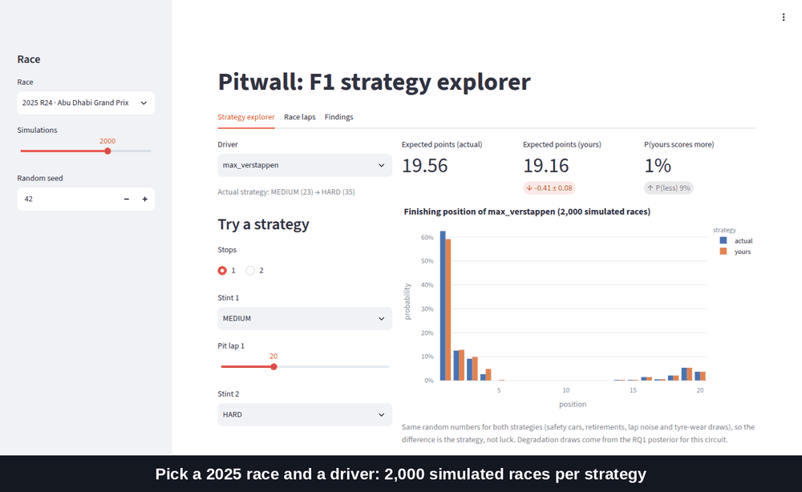
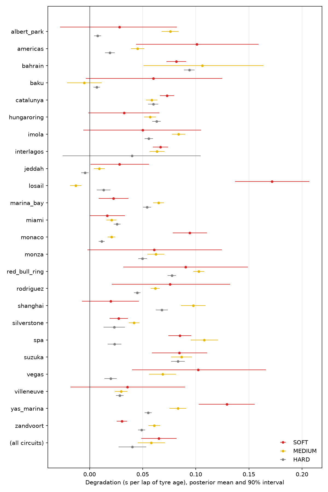
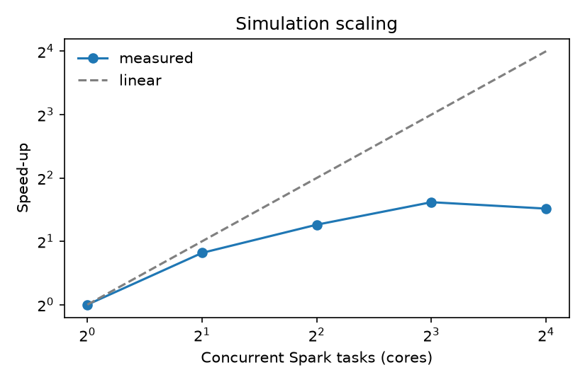
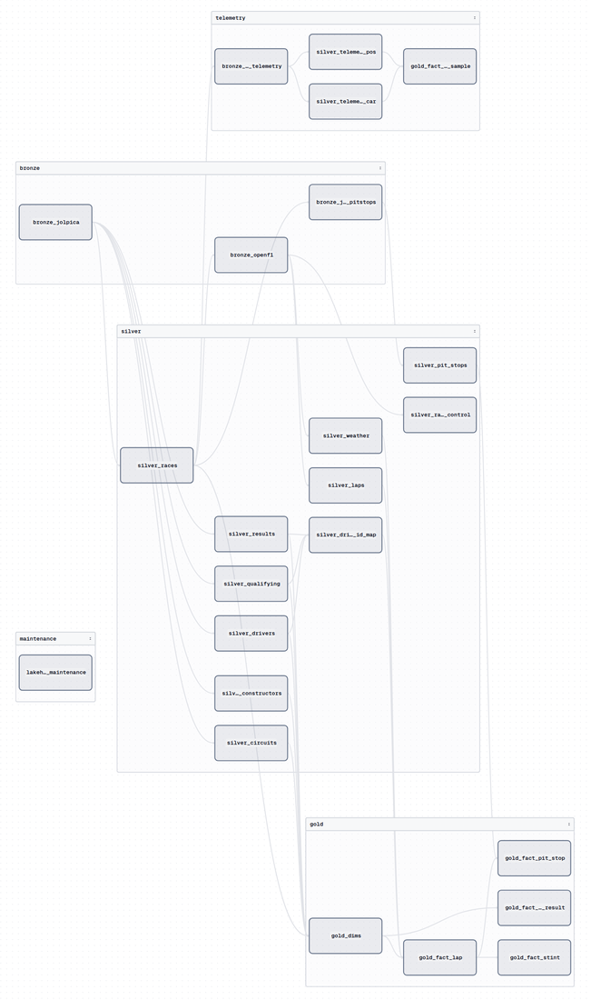

# Tyres, undercuts and a million simulated races: what three seasons of F1 data say about strategy

*Carlos Salguero · October 2026 · code and full write-ups: [Pitwall](../../README.md)*

Every Formula 1 broadcast is full of strategy claims stated as fact. "The softs will fall off a cliff." "The undercut is worth two seconds here." "They left a podium on the table." I wanted to know how many of those claims hold up when you put a number on them. Just as important, I wanted to know how sure you can be about that number.

Pitwall is the project that came out of that: a lakehouse of F1 timing data and three research questions, each with its question, estimand and evaluation written down **before** any model was fitted. This post covers what I found, what didn't work, and what I'd do differently.

## The three questions

1. **How fast do tyres really wear?** Seconds per lap of tyre age, by compound and circuit, with honest uncertainty.
2. **Does the undercut actually work?** Does pitting before your rival *cause* you to come out ahead, or do cars that pit first just happen to be in better positions?
3. **What strategy maximises points, and did teams pick it?** A race simulator, tested on a season it never saw.

The plan fixed the train/test split (2023–24 to fit, 2025 to test), the metrics and the pass/fail bars up front. Every later change is logged with its reason in a deviations table. Some of the results below fail their own bar, and I report them that way.

## The data, and a mid-project surprise

Results come from [Jolpica](https://github.com/jolpica/jolpica-f1) (2018–2025). Lap-level data was going to come from FastF1. Then, halfway through, the F1 timing archive behind FastF1 started requiring an F1 TV login for every season ([Fast-F1 #978](https://github.com/theOehrly/Fast-F1/issues/978)). I switched lap, tyre, weather and telemetry data to [OpenF1](https://openf1.org). It's free, but it only starts in 2023, so the lap-level questions cover three seasons, not eight. The switch is recorded as an architecture decision. Because silver tables have the same schema whichever source fed them, nothing downstream changed.

The final dataset: 77,238 race laps, 3,889 stints, 2,558 pit stops, plus about 33 million telemetry samples for the 2024 season.

## RQ1: tyres wear less than you'd think, and the track matters most

The naive way to measure tyre wear is to plot lap time against tyre age and fit a line. That line is badly confounded. As the stint goes on, the car also burns fuel and gets faster by about 0.05 s per lap, which hides much of the wear. Traffic, track temperature and the driver also move lap times.

So I fitted a hierarchical Bayesian model in PyMC. Lap time is a race offset, plus driver and compound effects, plus a fuel term, plus wear × tyre age, plus a traffic penalty. Wear is partially pooled across circuits, so a track with two races borrows strength from the rest.

**Fuel-corrected wear is 0.065 s per lap of age on the soft, 0.058 on the medium and 0.040 on the hard** (90% intervals about ±0.015). By lap 25 of a stint, a soft is losing about 1.6 s per lap to a fresh one.

The more interesting finding is in the spread:

- **The circuit matters about 7× more than the driver.** Mediums at Spa, Bahrain and the Red Bull Ring lose about 0.1 s per lap of age; at Baku and Losail they lose almost nothing. Driver-to-driver differences in tyre management are real but small.
- **Heat costs time.** Each 8 °C of extra track temperature adds about 0.16 s per lap by the end of a 25-lap stint.
- **"Soft > medium > hard" is weaker than expected.** It holds on average, but only clearly at 7 of 24 circuits. Pirelli brings a different trio of compounds to each track, so "the soft" isn't one tyre.

On the held-out 2025 season, the model gave the best forecasts of how a stint evolves from its first three laps: RMSE 1.17 s, against 1.23 for a per-stint regression baseline and 1.29 for LightGBM.

**What failed:** the 90% prediction intervals cover only 82% of real laps. The model is too sure of itself. Its lap-to-lap noise is independent, but real laps aren't: a driver stuck in a DRS train is slow for several laps in a row. A stint-level random slope or autocorrelated noise is the next thing to try. I left the miss in the headline rather than widen the intervals until they passed.

## RQ2: the undercut works, but only where tyres wear

This is a causal question, and the obvious comparison gives the wrong answer. Cars that pit first aren't a random sample. They tend to be on older tyres, under more pressure, or already fading.

The design compares **pit cycles**: two cars within 3 s of each other, both on worn tyres, that both stop within a few laps of each other, with no safety car in between. The "treatment" is that the car behind stops first; the outcome is whether it comes out ahead once both have stopped. That gives 548 cycles from 55 races. I estimated the effect with double machine learning (cross-fitted by race, so a race never informs its own predictions), and cross-checked it with inverse-propensity weighting and an independent EconML fit.

**Stopping first raises the chance of coming out ahead by 38 percentage points (95% CI 26 to 49).** Raw rates are 54% ahead when you go first and 20% when your rival does. The adjusted estimators agree within 3 pp.

The effect depends on tyre wear, which is what the physics predicts:

| Circuit wear (from RQ1) | Effect of stopping first |
|---|---|
| High | +50 pp |
| Medium | +49 pp |
| Low | −3 pp (CI −25 to +20) |

Fresh tyres are worth the most where old ones fade fastest. At low-wear tracks the out-lap gain doesn't make up for the time lost in the pit lane.

The robustness checks mostly pass. Covariates balance after weighting, overlap is good, and shuffling the treatment gives zero. An unmeasured confounder would need a risk ratio of about 4 with both the decision and the outcome to erase the result.

**What failed:** a placebo test. Stopping can't change the gap in the three laps *before* the stop, yet cars that went first had already lost 0.65 s over those laps. Something I hadn't controlled for, recent pace, drives the decision. Adding that trend as a covariate moved the estimate *up*, to +44 pp. The cars that undercut were the ones already fading, so leaving it out understates the undercut. The pre-registered lap-by-lap design also failed: stopping on any given lap is too rare to find comparable cars, and I switched designs before the full run, with the reason logged.

## RQ3: a good forecaster, a bad advisor

The last question needs a simulator. Pitwall simulates every car, every lap, thousands of times per race. Lap times come from a fresh draw of the RQ1 posterior in each run, so uncertainty about tyre wear carries through. Pit losses and safety-car rates are estimated per circuit from earlier seasons. Overtaking is a coin flip weighted by the pace difference, and position changes through the pit lane are never blocked, which is what lets the undercut emerge on its own.

Two pace settings were tuned on the 2024 season and then frozen, so 2025 stayed a true test.

**As a forecaster, it works.** Across 24 races in 2025, its ranked probability score is 0.128, against 0.176 for "everyone finishes where they started". It's better in 19 of the 24 races.

**It runs at scale.** The simulator is vectorised NumPy, distributed over Spark. A million races of the 2025 Australian GP take 20.5 seconds on an 8-core laptop. The headline from that run was Norris winning 57% of the time; he won.

**As an advisor, it fails, and that's the most useful finding in the project.** For each of 479 driver-races, I simulated about 550 alternative one- and two-stop strategies. I picked the best on half of the simulations and scored it on the other half, so luck couldn't inflate the result. The simulator says the median driver left **2.6 points per race** on the table.

I don't believe that. It implies about 50 points per race across the field, and real strategy teams with full telemetry don't leave that much. The gains are also largest where the simulator is weakest: wet races (it has no wet-weather model) and the races it backtests worst. The backtest already showed it's overconfident; drivers it gave 2% for the top 10 made it 17% of the time. **A simulator that is too sure about the finishing order is also too sure that a different pit lap would have changed it.**

The lesson: forecasting a result is a much easier bar than ranking counterfactual strategies, because comparisons between strategies amplify exactly the effects a model gets slightly wrong. I report the decision analysis as a negative result, and the app frames it as a "what if" tool, not a verdict on teams.

## The platform underneath

The science is the point, but it rests on infrastructure that had to be trustworthy:

- **Medallion lakehouse on Delta Lake.** Raw API responses go into bronze unchanged; silver is cleaned and typed; gold is a star schema (laps, stints, pit stops, telemetry, results) with deterministic hash keys.
- **Reproducibility checked, not assumed.** Rebuilding a season from bronze reproduces every silver and gold table bit-for-bit (row count + checksum). Getting there flushed out two real bugs: a MERGE whose result depended on the order of runs, and float sums that depended on partition order.
- **Quality gates.** Every load runs expectations; failing rows go to quarantine, and every gate run is logged. The worst rate was 0.42%, almost all red-flag laps.
- **Measured, not guessed, performance work.** One telemetry table had been written as 456 files of 0.6 MB each. Compacting it and Z-ordering by driver cut a typical query from 19 files read to 1, and from 0.47 s to 0.29 s. I then fixed the writer so it produces the compact layout in the first place.
- **Dagster** schedules everything as season-partitioned assets.

## What I'd do next

1. **Fix RQ1's intervals.** Add stint-level random wear and autocorrelated lap noise, and a tyre "cliff" term so very long stints stop looking cheap.
2. **Wire RQ2 into RQ3.** Calibrate the simulator's overtaking model so the simulated undercut matches the measured +38 pp, tuned on the validation season like the pace settings.
3. **Model the rival's response.** Right now every other car's strategy is held fixed, which is exactly what doesn't happen in a real undercut.
4. **More history.** If FastF1 gains F1 TV authentication, the code to extend lap-level data back to 2018 is already there.

## Takeaways

- **Fuel hides tyre wear.** Correct for it and the circuit, not the compound or the driver, is what decides how fast tyres go off.
- **The undercut is real and large where tyres wear,** and close to worthless where they don't.
- **A model that predicts well can still advise badly.** Report its uncertainty, test it on data it hasn't seen, and say so when it fails its own bar.

Everything is reproducible from a clone: `make up && make backfill && make research` rebuilds the lakehouse and every number in this post, and `make app` opens the explorer shown at the top. The full write-ups, with methods, diagnostics and limitations, are in [`reports/`](../../reports/).

*Data from Jolpica-F1 and OpenF1, used for non-commercial, educational purposes. This project is not associated with Formula 1 or the FIA.*
