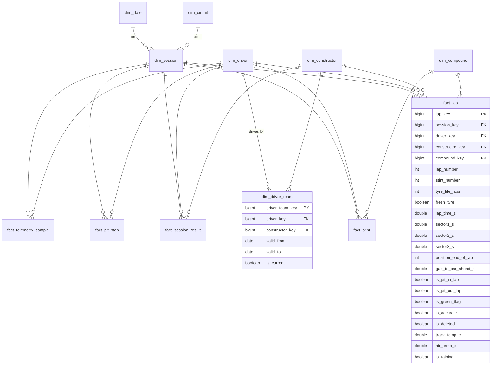

# Data model

Gold layer: a Kimball star schema with one central fact table (`fact_lap`), supporting facts, and conformed dimensions. Feature tables for modeling are derived from gold and documented at the end.

Conventions:
- `*_key` = deterministic surrogate key (`xxhash64` of the natural key, BIGINT).
- Times in **seconds** (DOUBLE), speeds in **km/h**, temperatures in **°C**, timestamps in **UTC**.
- Every table carries `_updated_at` (TIMESTAMP) and `_source_batch_id` (STRING) for lineage.

## ERD

## Dimensions

| Table | Grain | Natural key | Type | Notes |
|---|---|---|---|---|
| `dim_driver` | one row per driver | `driver_id` (Jolpica) | SCD1 | name, code (VER), nationality, dob, permanent number |
| `dim_constructor` | one row per constructor | `constructor_id` | SCD1 | name, nationality. Rebrands (e.g. AlphaTauri → RB) are separate constructors linked by `lineage_group` |
| `dim_driver_team` | one row per driver × constructor spell | `driver_id, constructor_id, valid_from` | **SCD2** | Built from race-by-race entries; mid-season swaps create new rows |
| `dim_circuit` | one row per circuit | `circuit_id` | SCD1 | lat/lon, country, length_km, laps, pit-lane loss estimate (derived), degradation tier (derived from RQ1) |
| `dim_session` | one row per session | `season, round, session_type` | static | event name, circuit_key, date_key, scheduled laps, start time UTC |
| `dim_compound` | one row per compound | `compound` | static | SOFT/MEDIUM/HARD/INTERMEDIATE/WET/UNKNOWN; is_dry |
| `dim_date` | one row per day | `date` | static | standard calendar attributes |

## Facts

| Table | Grain | Natural key | Measures | Partition |
|---|---|---|---|---|
| `fact_lap` | driver × lap × session | `season, round, session_type, driver_number, lap_number` | lap/sector times, tyre life, position, gap, flags, weather at lap | `season` |
| `fact_stint` | driver × stint × session | `… driver_number, stint_number` | start/end lap, compound, laps, mean/median green-flag pace, raw degradation slope | `season` |
| `fact_pit_stop` | driver × stop × race | `season, round, driver_id, stop_number` | lap, pit-lane duration, compound before/after, position before/after, under SC/VSC/red flag. Stationary time is not published by any free source, so it isn't modeled | `season` |
| `fact_session_result` | driver × session | `season, round, session_type, driver_id` | grid, finish position, points, status, classified flag | `season` |
| `fact_telemetry_sample` | driver × sample × session | `… driver_number, session_time_s` | speed, rpm, gear, throttle, brake, drs, x, y, z, distance | `season, event_round, session_type` |

`fact_telemetry_sample` is a large, "periodic snapshot" style fact. Analytical queries rarely join it to dims directly. It is mainly read to build corner-level features.

## Silver helper tables

| Table | Purpose |
|---|---|
| `driver_id_map` | Per race weekend (`season, round, driver_number`): `driver_id` (Jolpica) ↔ `code` ↔ car number, built from Jolpica entry lists. Checked 1:1 in both directions on every build. |
| `race_control` | Track-status periods `[start_s, end_s)` (green, SC, VSC, VSC ending, red flag) in session time; used for per-lap track status, `is_neutralized` and SC events for RQ3 |
| `weather`, `telemetry_car`, `telemetry_pos` | Typed OpenF1 (or FastF1) samples in session time; all lap-level silver tables have the same schema whichever source fed them ([ADR-0006](adr/0006-openf1-as-lap-data-source.md)) |

## Feature tables (one per research question)

### `feat_tire_degradation` (RQ1) — grain: green-flag race lap

| Column | Definition |
|---|---|
| `lap_time_s` | target |
| `tyre_life_laps` | laps on current set (incl. laps from earlier sessions for used sets) |
| `compound` | categorical |
| `fuel_proxy` | `scheduled_laps − lap_number` (remaining race distance, a proxy for fuel mass) |
| `track_temp_c` | at lap start (nearest weather sample, backward-looking) |
| `circuit_id`, `driver_id`, `constructor_id`, `season` | grouping factors for hierarchy |
| `in_traffic` | `gap_to_car_ahead_s < 1.5` |

Filters: race sessions, green flag, not pit in/out laps, `is_accurate`, dry compounds, not lap 1.

### `feat_pit_decision` (RQ2) — grain: driver × lap where a rival is within 3 s

| Column | Definition |
|---|---|
| `treated` | driver pits this lap while the rival has not yet pitted in this window |
| `outcome_ahead_after_cycle` | driver is ahead of rival once both have pitted |
| `outcome_gap_change_s` | gap change from lap *t* to the end of the pit cycle |
| covariates | gap to rival, tyre life (both), compound (both), laps remaining, circuit degradation tier, track temp, traffic expected on rejoin, position |

Only information available at lap *t* goes into covariates. Pit cycles disrupted by an SC/VSC are excluded (post-treatment shocks).

### `feat_race_sim_params` (RQ3) — grain: race

Pit loss distribution, SC/VSC hazard per lap (historical by circuit), starting grid, degradation posterior sample references.

### `feat_prerace` (RQ4) — grain: driver × race

Grid, qualifying gap to pole, long-run practice pace, rolling form (last N races), circuit history. Only uses information before race start.
