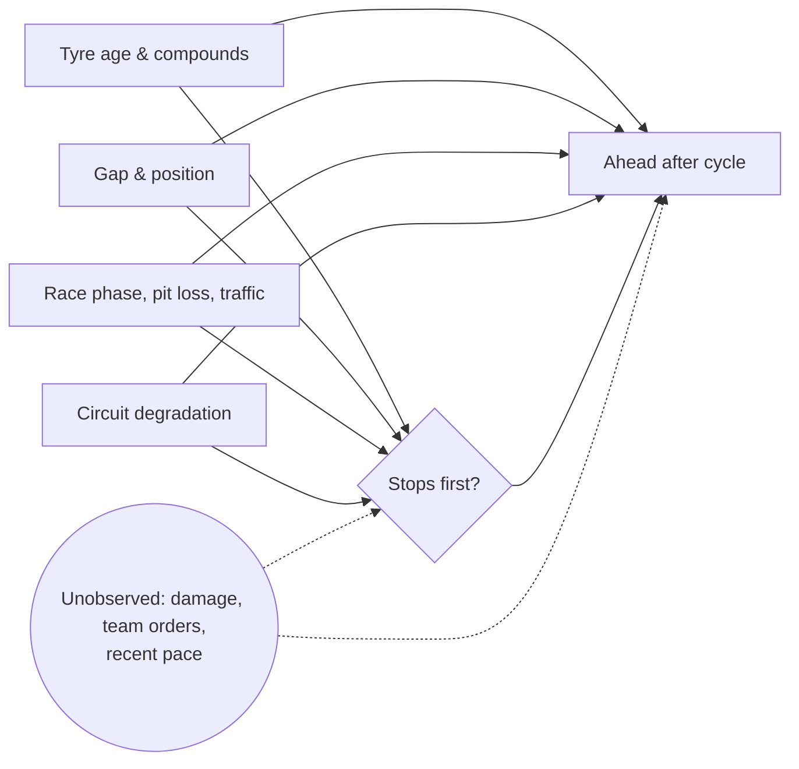

# RQ2 — Does the undercut work?

**Takeaway.** When two cars fighting within 3 s both stop within a few laps of each other, the car behind that stops **first** ends up ahead after both stops **54%** of the time. When the rival stops first, it does so **20%** of the time. Adjusting for tyre age, compounds, gap, race phase, pit loss and rejoin traffic, stopping first raises the chance of coming out ahead by **+38 percentage points (95% CI +26 to +49)**. The effect is concentrated at circuits where tyres wear fast (about +50 pp). At low-wear circuits it's indistinguishable from zero.

A placebo check flags that cars that went first were already losing time beforehand. Controlling for that recent pace makes the estimated effect slightly larger, not smaller.

Run: MLflow `rq2-undercut`, run `9bfc9ca7fdac42bb9cdbaefb3e423c51` · reproduce with `make rq2` · numbers from [`rq2/results.json`](rq2/results.json)

## Question and estimand

When two cars are fighting (gap < 3 s), does pitting first *cause* the car behind to end up ahead once both have pitted? The estimand is the average effect of stopping first, versus letting the rival stop first, on P(ahead after the pit cycle).

## Data and design

`features.feat_pit_cycle`, 2023–2025 races: **548 pit cycles from 55 races** (254 where the car behind stopped first).

- **Unit:** at the end of lap L, car *d* runs directly behind rival *r*, gap 0–3 s, both mid-stint with tyres at least 5 laps old, green flag, at least 8 laps to go. The next stops of both cars are within 8 laps of each other, and the first of them comes on lap L+1.
- **Treatment:** *d* stops first. **Control:** *r* stops first. Same-lap stops are excluded.
- **Outcome:** is *d* ahead at the end of the lap after the later stop? Secondary outcome: the change in the gap, in seconds.
- **Covariates** (all at the end of lap L, before the decision): gap, position, both cars' tyre age and compound, laps remaining, share of race remaining, track temperature, circuit pit loss, cars within one pit loss behind *d* (rejoin traffic), circuit degradation tier (RQ1 posterior tertiles).
- **Exclusions:** any SC/VSC/red-flag lap during the cycle (a post-treatment shock); either car not classified at the outcome lap.

This design replaced the pre-registered lap-level design before the full run. The lap-level one is reported below as secondary, and why it changed is in the research plan §6.

## Method

| Estimator | Details |
|---|---|
| Naive | Difference in means; race-clustered (CR1) standard errors |
| IPW | Hajek weights from a gradient-boosted propensity model, cross-fitted with folds grouped by race; trimmed to propensities in [0.05, 0.95]; race-cluster bootstrap CI (500 draws) |
| **DML (primary)** | Partially linear model, partialling out; gradient-boosted nuisance models, 5-fold cross-fitting grouped by race; cluster-robust influence-function SE |
| EconML LinearDML | Cross-check with an independent implementation |

## Results

| Estimator | Effect on P(ahead) | 95% CI |
|---|---|---|
| Naive | +33.9 pp | +22.1 to +45.7 |
| IPW | +39.0 pp | +25.9 to +50.8 |
| **DML** | **+37.7 pp** | **+26.4 to +49.0** |
| EconML LinearDML | +40.9 pp | +33.7 to +48.2 |

The three adjusted estimators agree within about 3 pp and sit 4–7 pp above the naive difference. Cars that stop first tend to be in a worse spot, which hides part of the effect.

**Secondary outcome:** stopping first gains **4.8 s (2.5 to 7.1)** on the rival over the cycle.

**Heterogeneity by circuit degradation tier (DML):**

| Tier | Effect | 95% CI | Cycles |
|---|---|---|---|
| High | +49.5 pp | +35.9 to +63.2 | 240 |
| Mid | +49.0 pp | +34.6 to +63.4 | 183 |
| Low | −2.6 pp | −25.2 to +19.9 | 120 |

This is what tyre physics predicts. Fresh tyres are worth more where old ones fade fastest; where wear is low, the out-lap gain can't make up for the pit-lane traffic.

## Diagnostics and robustness

- **Overlap:** 99.1% of units have propensities inside [0.05, 0.95] (plot: [`rq2/propensity_overlap_cycle.png`](rq2/propensity_overlap_cycle.png)).
- **Balance:** the largest standardized mean difference drops from 0.34 to 0.089 after weighting. All covariates end below the 0.1 target.
- **Permuted treatment** (shuffled within race, 20 times): mean effect +0.02 (SD 0.04), consistent with zero, as it should be.
- **Unobserved confounding:** E-value **5.4**, and 4.1 for the confidence bound. To pull the confidence interval to zero, an unmeasured confounder would need a risk ratio of about 4 with both the decision and the outcome; explaining away the point estimate would take 5.4.
- **Placebo outcome — not null.** On the gap change over the three laps *before* the stop, DML gives **−0.65 s (−0.91 to −0.38)**: cars about to stop first were already losing ground. Stopping can't have caused that. Recent pace, i.e. tyres already fading, influences who goes first and isn't fully captured by tyre age.
- **Controlling for that trend:** adding the three-lap gap trend (known at decision time) as a covariate gives **+44.2 pp (+33.8 to +54.6)**. Cars that go first are the ones fading, so leaving recent pace out *understates* the undercut.
- **Lap-level design (secondary):** 21,089 pair-laps, but stopping on a given lap is rare (2.3%). Only 14% of units survive trimming, and balance fails (max SMD 0.26 after weighting). Its DML estimate, +19 pp (+11 to +26), isn't reliable and is reported for transparency only.

## Limitations

- **Strategic interaction.** The rival reacts: if *d* stops, *r* often stops the next lap. The design conditions on both stopping within 8 laps, which is the question as framed, but it isn't a pure "stop now vs never" contrast.
- **Unobserved factors:** team orders, damage, tyre temperature and fuel targets. The E-value says it would take a strong confounder to explain the effect away.
- **Small sample per tier** (120–240 cycles), 2023–2025 only, all in one regulation era.
- **"Ahead after the cycle" is not the final result.** Positions can change again later in the race.
