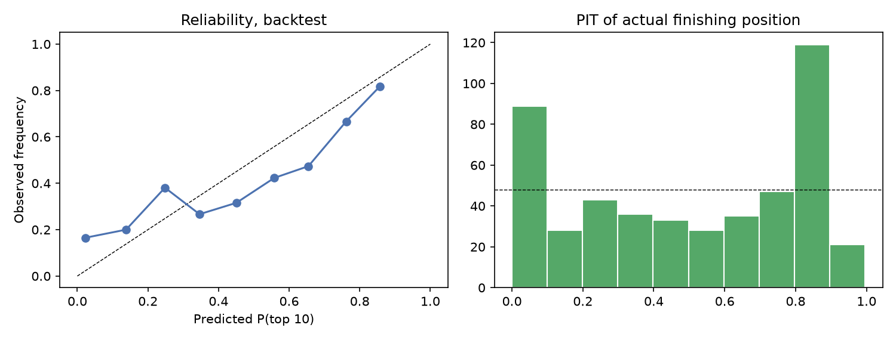

# RQ3 — What strategy maximizes points, and did teams pick it?

**Takeaway.** A full-field Monte Carlo simulator, fed the RQ1 posterior and only pre-race information, predicts 2025 finishing positions clearly better than "finish where you started". Ranked probability score is **0.128 vs 0.176**, better in 19 of 24 races. Spark runs **a million simulated races in 20 seconds** on an 8-core (16-thread) laptop.

The simulator is still overconfident, though. And its strategy recommendations are **not credible**: it says the median driver left 2.6 points per race on the table, which no team would. We report that as a negative result. A simulator good enough to forecast results is not automatically good enough to rank strategies. Counterfactual comparisons amplify exactly the effects it gets wrong.

Run: MLflow `rq3-strategy`, run `71db65c45f9a4f6aaaf3f43c5fa0cbd6` · reproduce with `make rq3` · numbers from [`rq3/results.json`](rq3/results.json)

## The simulator

Every race is simulated lap by lap for the whole field, vectorized over simulations ([`simulation/field.py`](../src/pitwall/simulation/field.py)):

- **Lap time** = base + car pace + compound pace + fuel effect × laps left + wear × tyre age + lap noise. Wear, compound pace and fuel come from one **RQ1 posterior draw per simulation**, so parameter uncertainty propagates. Wear is floored at zero.
- **Car pace** = pace scale × qualifying gap to pole + a per-race deviation.
- **Pit stops** cost the circuit's pit loss (in-lap + out-lap − 2 × clean lap, from *earlier* seasons, shrunk toward the all-circuit median). Stops under a safety car are discounted.
- **Safety cars / VSC** start with the circuit's historical per-lap hazard (earlier seasons, shrunk toward the global rate), last 4 laps, and bunch the field.
- **Overtaking:** a faster car only passes if its pace advantage wins a logistic coin flip; otherwise it is held up. Position changes through the pit lane are never blocked, which is what lets the undercut emerge.
- **Retirements:** per-lap hazard from 2018–2024 results (0.0024 per lap, about 13% per car per race).

The two pace settings were **tuned on the 2024 backtest** and then frozen: scale 1.0, race-pace noise 0.1 s/lap ([grid](rq3/pace_tuning.csv)). The chosen point sits on the grid's edge, but the score surface is flat there (2024 RPS 0.0989 vs 0.0991 for the next setting). 2025 is therefore a true held-out test. Strategies come from what each driver actually ran (`fact_stint`). All inputs are in `features.feat_race_sim_params` / `feat_race_sim_cars`.

## Backtest: 2025 season, actual strategies

10,000 simulated races per Grand Prix, scored against the real result.

| | Model | Baseline: finish = grid |
|---|---|---|
| Ranked probability score (lower is better) | **0.128** | 0.176 |
| Per-race RPS improvement | **0.049 (95% CI 0.031 to 0.066)** | — |
| Races where the model is better | 19 of 24 (79%) | — |
| Brier score, race winner | 0.0304 | 0.0334 |
| Expected calibration error, P(top 10) | 0.093 | — |

**Calibration isn't met.** Drivers the model gives about 2% for the top 10 make it 17% of the time (121 driver-races), and mid-range probabilities run too high. The PIT histogram is U-shaped, the signature of predictive distributions that are too narrow. The biggest misses are Miami and Canada. The biggest wins are Zandvoort, Australia (a wet race, where the grid was a poor guide) and Las Vegas.

## Decision analysis

For each driver in each race, about 550 legal one- and two-stop dry strategies were simulated with everyone else's strategy fixed, using common random numbers. The best alternative was **chosen on one half of the simulations and scored on the other half**, so the gain isn't inflated by picking the luckiest of 550 noisy estimates.

| | Value |
|---|---|
| Driver-races analyzed | 479 |
| Mean expected points from the best alternative | +4.0 (95% CI +2.9 to +5.3, race bootstrap) |
| Median | +2.6 |
| Share where actual was within 0.5 pts of the best | 20% |
| Dry races only (21 races) | mean +3.4, median +2.3 |
| Wet-affected races (Australia, Silverstone, Spa) | mean +8.6 |

**We don't believe these numbers, and the report says so rather than headline them.**

- A median of 2.6 points per driver per race means about 50 points per race across the field. Teams with full telemetry and dedicated strategy staff don't leave that on the table.
- The gains are largest exactly where the simulator is weakest. In wet races the dry-only simulator maps intermediate stints to mediums. Canada and Miami are its worst backtests.
- The backtest already shows overconfidence. A simulator too sure about finishing order will be too sure that a different pit lap would have changed it.

What *is* supported: the simulator reproduces the undercut mechanism (`tests/test_rq3.py`), it adds information over the grid, and its uncertainty plumbing (posterior draws, safety cars, paired comparisons, held-out selection) works. The per-driver analysis is in [`rq3/decision_analysis.csv`](rq3/decision_analysis.csv), and the [Streamlit explorer](../app/streamlit_app.py) lets you try strategies interactively. Treat both as a tool for exploring "what if", not a verdict on teams.

## Scale

| Concurrent Spark tasks | 1 | 2 | 4 | 8 | 16 |
|---|---|---|---|---|---|
| Time for 200,000 races (s) | 14.4 | 8.2 | 6.0 | 4.7 | 5.0 |
| Speed-up | 1.0 | 1.8 | 2.4 | 3.1 | 2.9 |

**One million races** of the 2025 Australian GP took **20.5 s** with 16 concurrent tasks on 8 cores (about 49,000 races/s). The headline from that run is Norris P(win) 57%, Piastri 34%, Verstappen 4% (the real race: Norris won, Verstappen second).

Scaling flattens beyond 8 tasks. The laptop has 8 physical cores (16 threads), and at 200k races each task runs only a few hundred milliseconds of NumPy, so Spark's per-task overhead (Python worker start-up, Arrow serialization, the shuffle that sums counts) starts to dominate. The decision analysis (about 550 candidates × 479 driver-races × 800 simulations, roughly 210 million races) keeps all 16 threads busy for about 45 minutes; that is the workload Spark is for. On a cluster the same code distributes `(race, driver, batch)` tasks unchanged.

## Limitations and next steps

- **Overconfidence.** Race-pace uncertainty is a single constant tuned on one season. Qualifying gaps don't capture race-pace differences between teams (tyre management, low- vs high-downforce set-ups), and the simulator has no team-specific race pace.
- **Dry-only physics.** No wet tyres, crossover timing or weather changes. Wet races should be excluded from strategy conclusions or modeled properly.
- **Missing effects:** tyre cliffs (linear wear makes very long stints look cheap), overtaking difficulty per circuit, DRS trains, team orders, and the rival's *response* to a strategy change (everyone else is held fixed).
- **RQ2 isn't wired in.** The undercut emerges from the physics. A next step is to calibrate the overtaking constants so the simulated undercut matches RQ2's +38 pp, and to tune them on the validation season like the pace settings.
