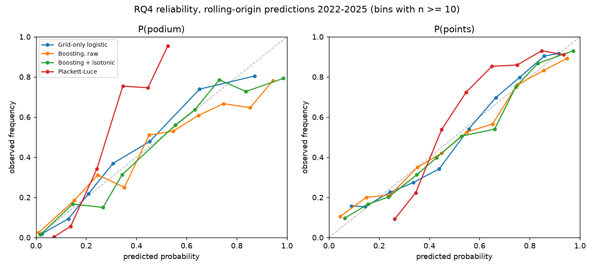

# RQ4 — Calibrated pre-race predictions (stretch)

**Takeaway.** Before the lights go out, **grid position alone is very hard to beat**. A boosted model that adds qualifying pace, driver and team form and circuit history can be made well calibrated: isotonic calibration brings its podium calibration error to **0.013**. But it isn't more *accurate* than a logistic regression on the grid slot. Its podium Brier score is 0.0744 vs **0.0700** for the grid baseline (95% CI on the difference −0.0095 to +0.0004). For points it gains a little, 0.1623 vs 0.1652, but the CI includes zero and the gain disappears in 2024–2025.

A Plackett–Luce rank model, which keeps probabilities coherent across the field, is badly miscalibrated (ECE 0.11). It is far too flat at the front. Both results are negative, and they are reported as such: the starting grid already prices in almost everything the free pre-race data knows.

Run: MLflow `rq4-prerace`, run `d25f49cf2615442dbc729deeaba1099a` · reproduce with `make rq4` · numbers from [`rq4/results.json`](rq4/results.json), predictions in [`rq4/predictions.csv`](rq4/predictions.csv)

## Question and estimand

For every driver in a Grand Prix, what are P(podium) (finish ≤ 3) and P(points) (scores points), using only information available before the start? Are the probabilities calibrated, and are they better than the grid alone? The specification below was recorded in the research plan before any model was fitted (research plan §RQ4 and §6).

## Data

`features.feat_prerace`: one row per driver × Grand Prix, **2018–2025, 173 races, 3,458 rows** (sprints excluded). RQ4 needs results only, so it isn't limited to the 2023+ lap-data window.

| Feature | Definition |
|---|---|
| `grid_pos`, `from_pit_lane` | grid after penalties; a pit-lane start is placed behind the last slot |
| `quali_position`, `quali_gap_pct` | qualifying position and gap to pole in %, capped at 7% (the 107% rule) |
| `driver_points_l5`, `driver_finish_l5`, `driver_dnf_l10`, `driver_starts` | driver form over the previous 5 (DNF: 10) races, and experience |
| `team_points_l5`, `team_finish_l5` | team form per car over the previous 5 races; rebrands (Toro Rosso → AlphaTauri → RB…) are one team |
| `circuit_pos_change` | mean \|finish − grid\| at the circuit in **earlier seasons** (missing for new venues) |

Form windows end one race before the current one. A test checks that changing a race's result leaves that race's features unchanged (`tests/test_rq4.py`).

## Method

| Model | Details |
|---|---|
| Baseline | Logistic regression on grid position (grid and log grid) |
| **Primary: boosting + isotonic** | Histogram gradient boosting, monotone decreasing in grid, qualifying position and gap, fixed hyperparameters (300 trees, learning rate 0.05, 15 leaves, ≥ 40 per leaf); isotonic calibration |
| Boosting + Platt | Same model, Platt scaling |
| Boosting, raw | Uncalibrated |
| Plackett–Luce | Rank model: linear strength per car (all features plus log grid, ridge), orders sampled best-first ∝ exp(strength); P(podium) and P(top 10) from 20,000 sampled orders |

**Rolling origin.** Before every race from 2021 on, every model is refit on all earlier races. Calibrators are refit before each race on the boosting model's out-of-sample predictions for all earlier races from 2021, so they never see the race they calibrate. Scoring covers **2022–2025** (92 races, 1,838 driver-races), when the calibrators have at least a season of data.

**Metrics.** Brier score (primary), log loss, expected calibration error (10 equal-width bins), reliability diagrams. CIs on the Brier difference vs the baseline come from bootstrapping races. "Calibrated" means ECE ≤ 0.03 for both targets.

## Results

### 2022–2025, rolling origin

| Model | Podium Brier | Δ vs grid (95% CI) | Podium ECE | Points Brier | Δ vs grid (95% CI) | Points ECE |
|---|---|---|---|---|---|---|
| **Grid-only logistic** | **0.0700** | — | 0.018 | 0.1652 | — | 0.037 |
| Boosting + isotonic (primary) | 0.0744 | −0.0044 (−0.0095 to +0.0004) | **0.013** | 0.1623 | +0.0029 (−0.0044 to +0.0097) | 0.032 |
| Boosting + Platt | 0.0733 | −0.0033 (−0.0078 to +0.0008) | 0.021 | **0.1613** | +0.0039 (−0.0028 to +0.0101) | 0.039 |
| Boosting, raw | 0.0755 | −0.0055 (−0.0110 to −0.0003) | 0.033 | 0.1610 | +0.0042 (−0.0029 to +0.0112) | 0.041 |
| Plackett–Luce | 0.0869 | −0.0169 (−0.0212 to −0.0127) | 0.111 | 0.1648 | +0.0004 (−0.0061 to +0.0069) | 0.129 |

Positive Δ means better than the grid baseline. Log loss tells the same story: podium 0.238 for the grid baseline, 0.255 for the primary model; points 0.507 vs 0.503.

- **Calibration works.** Isotonic calibration cuts the boosting model's podium ECE from 0.033 to 0.013, which meets the bar. For points it reaches 0.032, just missing the 0.03 bar; Platt doesn't do better (0.039).
- **Accuracy doesn't improve.** For podiums the grid baseline has the lowest Brier score in three of the four seasons. For points the boosted models beat it clearly in 2022 and 2023 (Brier 0.174 vs 0.185, and 0.168 vs 0.179). They tie in 2024 and lose in 2025 (0.173 vs 0.163). Form features help when the pecking order is stable from race to race and hurt when it shifts.
- **Pole-sitters are underrated.** Off pole, the primary model gives 74% for a podium against 80% observed. The grid baseline gives 87%.

### Why the rank model fails

| Grid slot | Podium rate | Grid-only | Boosting + isotonic | Plackett–Luce |
|---|---|---|---|---|
| 1 | 0.80 | 0.87 | 0.74 | **0.45** |
| 2 | 0.74 | 0.65 | 0.60 | **0.34** |
| 6–8 | 0.07 | 0.11 | 0.11 | **0.16** |
| 17+ | 0.01 | 0.00 | 0.02 | **0.07** |

Plackett–Luce has a single noise scale for the whole finishing order. Most of the likelihood comes from the midfield and the retirements, which are close to random, so the fitted strengths are compressed. The model is then far too uncertain about the front of the field, where the order is quite predictable. Its probabilities are coherent (P(podium) sums to exactly 3 per race; the boosted models give 3.1 and 10.1), but coherence doesn't fix the wrong noise scale. A rank model with position-dependent noise (e.g. a top-k or stagewise Plackett–Luce) would be the next step.

### Against the RQ3 simulator (2025)

The RQ3 simulator (frozen settings, 10,000 simulated races, actual strategies) has the most information of any model here, since it knows each team's strategy. It still scores worse than the grid baseline. Podium Brier is 0.081 vs 0.060 (Δ −0.021, 95% CI −0.037 to −0.006); points Brier is 0.183 vs 0.163 (Δ −0.020, −0.040 to −0.000). Its podium calibration is fine (ECE 0.035), but its top-10 probabilities are overconfident (ECE 0.093), consistent with the RQ3 report. On 2025, the grid baseline also beats the primary model (podium 0.0600 vs 0.0649; points 0.163 vs 0.173).

## Hypotheses and definition of done

| | Criterion (fixed in advance) | Result | Verdict |
|---|---|---|---|
| Calibration | ECE ≤ 0.03 for both targets | Podium 0.013; points 0.032 | **Partly met** |
| Better than baseline | Brier improvement with CI excluding 0 | Podium: worse (CI touches 0); points: +0.003, CI includes 0 | **Not met** |
| Rank model | Compared with the boosting model | Coherent but badly miscalibrated | Reported |

## Robustness and diagnostics

- **No leakage:** form windows exclude the current race (tested), circuit history uses earlier seasons only, and calibrators only see earlier out-of-sample predictions.
- **Season stability:** the per-season Brier scores are in `results.json` (`by_season`). For podiums the grid baseline is best in 2022, 2024 and 2025, and within 0.001 of the primary model in 2023. For points the picture changes over time, as described above.
- **Calibration method:** isotonic and Platt agree within 0.01 ECE. The choice doesn't change the conclusion.

## Limitations and next steps

- **Free pre-race data is thin.** There's no long-run practice pace, tyre allocation, weather forecast or upgrade information. These are what teams and bookmakers use to beat the grid. Adding practice long runs from OpenF1 (2023+) is the obvious next feature.
- **Hyperparameters weren't tuned,** by design, to keep the comparison honest. A tuned model on a validation season might close the small gap; it would not change the calibration story.
- **Weather:** rain reshuffles the order and isn't known before the race in this data. Wet races hurt every model equally.
- **Rank model:** position-dependent noise (top-k Plackett–Luce, or an ordered probit on finishing position) is needed for coherent *and* calibrated field-wide probabilities.
